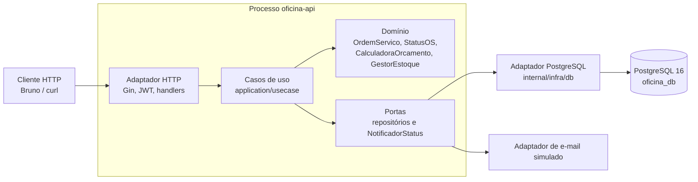
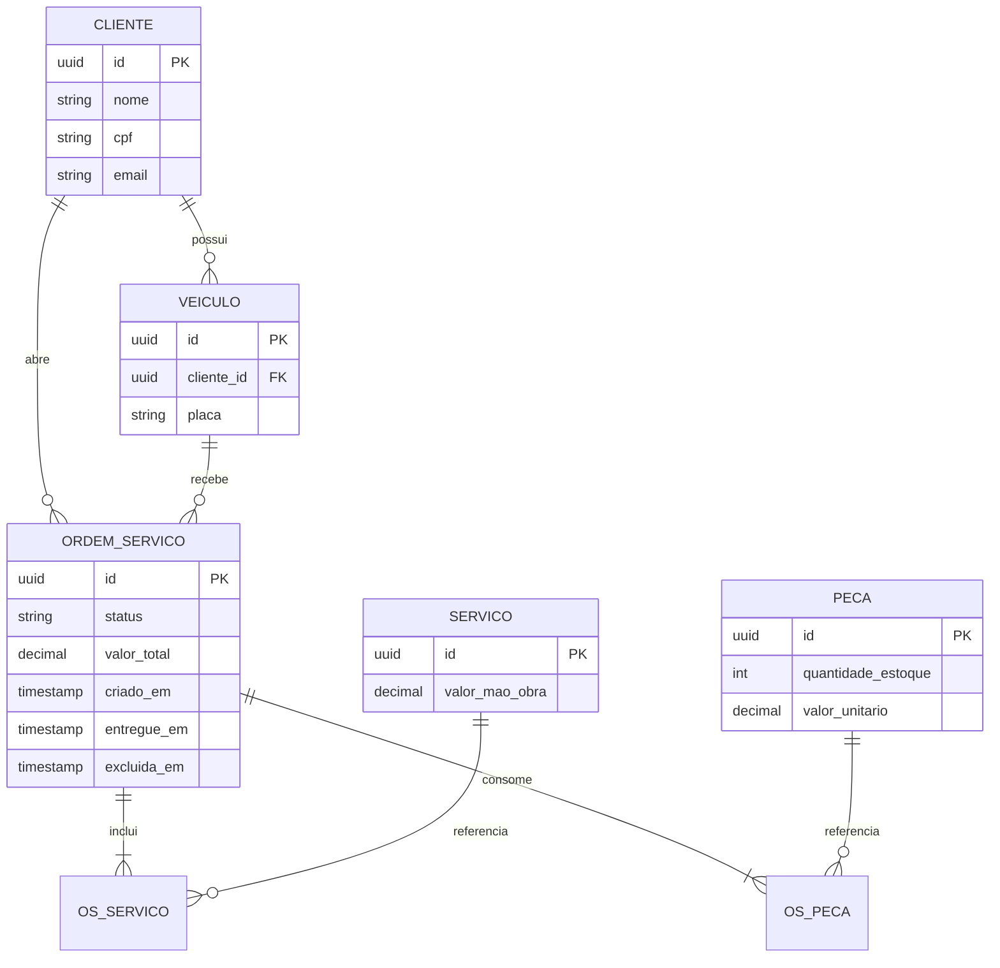
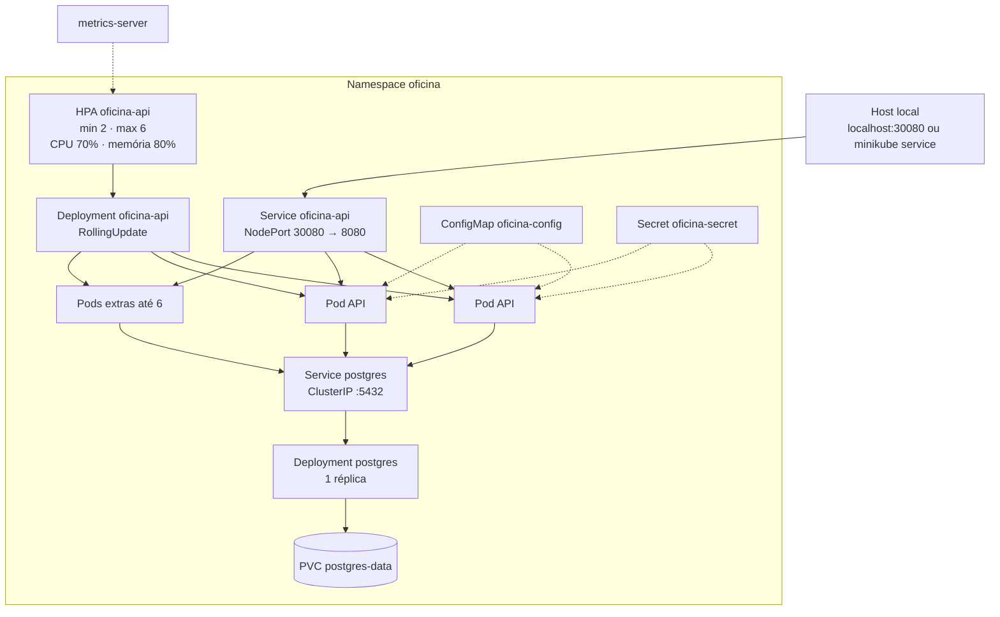
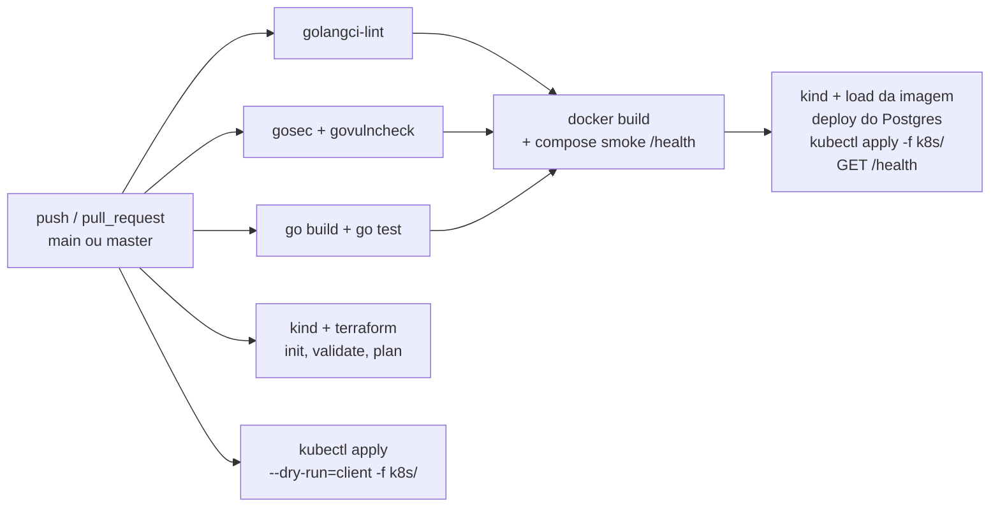
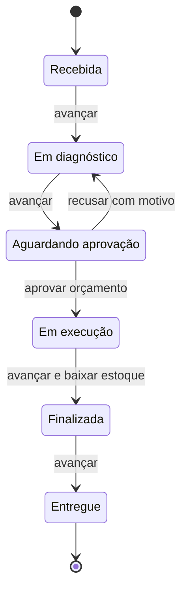

# Sistema Integrado de Atendimento e Execução de Serviços — Oficina Mecânica

[](https://github.com/gustavorichter/TechChalleng/actions/workflows/ci-cd.yml)

Back-end de gestão de ordens de serviço (OS) de uma oficina mecânica, refatorado em **Clean Architecture** e preparado para escalar horizontalmente em Kubernetes. O sistema cobre clientes, veículos, serviços, estoque de peças e o ciclo de vida da OS, com orçamento automático, baixa de estoque e consulta pública de status.

## Tech Challenge — Fase 2

**Grupo 21**

| Integrante | Contato |
|------------|---------|
| Gustavo André Richter | gustavo.richter@bling.com.br |
| Guilherme Montipó Nodari | guinodari@hotmail.com |
| Diego Poleto | diegopoleto10@gmail.com |

| Entregável da Fase 1 | Link |
|----------------------|------|
| Vídeo da apresentação | [Google Drive](https://drive.google.com/file/d/1DIrIJzwhTTDOoqtOU-DmangmCeSFKukc/view?usp=sharing) |
| Documentação DDD (Miro) | [Board Miro](https://miro.com/welcomeonboard/bmZ0RDZva2xEaHZ0STFGVlQrWFhtcXlnMnRBYklUN0tkcWM3ajJ3cGkzd3BDY3B6TGJ3dTR0UkNSYWJBQ0VZZ2tTMElJZ1h3NVNUNUpybmU2cmFURG13emcrQmswRHVxemtESmhSMHZqVGN1bkMzTE1SSmo4U0p6d1E4ZExnYVpBd044SHFHaVlWYWk0d3NxeHNmeG9BPT0hdjE=?share_link_id=382550460994) |
| Código-fonte | [GitHub](https://github.com/gustavorichter/TechChalleng) |
| Relatório de vulnerabilidades | [Google Drive](https://drive.google.com/file/d/1lLypdttNCF8Rw-6RwmpV7TVulzg_0uaa/view?usp=sharing) |

O checklist da gravação da Fase 2 está na [seção 6](#6-checklist-para-a-gravação-do-vídeo).

---

## 1. Descrição da Solução

A aplicação continua um monolito modular em Go. A Fase 2 separa com rigor as camadas da Clean Architecture e tira a execução do processo único do Docker Compose para um Deployment com Horizontal Pod Autoscaler (HPA).

### Arquitetura refatorada

O domínio não importa banco, HTTP nem Kubernetes. A aplicação orquestra os casos de uso por portas. A infraestrutura implementa essas portas.

```
cmd/api/                 Composição (wiring) dos adaptadores e casos de uso
internal/
  domain/                Entidades, value objects, máquina de estados e serviços de domínio
    entity/              Cliente, Veículo, Serviço, Peça, OrdemServico (Aggregate Root)
    valobj/              CPF, CNPJ, Placa, StatusOS
    service/             CalculadoraOrcamento, GestorEstoque
  application/           Casos de uso e DTOs
    port/                ClienteRepository, VeiculoRepository, ServicoRepository,
                         PecaRepository, OrdemServicoRepository, NotificadorStatus
    usecase/             CRUD e ciclo de vida da OS
  infra/                 Adaptadores
    db/                  PostgreSQL via pgx (implementa as portas de repositório)
    http/                Gin, JWT, handlers e middleware
    notification/        E-mail simulado na mudança de status
pkg/validator/           CPF, CNPJ e placa
k8s/                     Manifestos da API (ConfigMap, Secret, Deployment, Service, HPA)
infra/                   Terraform local: namespace, PostgreSQL, API e HPA
```

A regra de orçamento, a máquina de estados da OS e a baixa de estoque permanecem no domínio. Trocar o driver do banco ou o framework HTTP não altera essas regras.

### Objetivos de escalabilidade

| Objetivo | Como a solução atende |
|----------|------------------------|
| Mais de uma instância da API | Deployment `oficina-api` nasce com **2 réplicas** e RollingUpdate (`maxUnavailable: 0`). |
| Escala automática sob carga | HPA `oficina-api` entre **2 e 6** réplicas, com alvo de **70% de CPU** e **80% de memória** sobre os requests do container (`50m` / `64Mi`). |
| Escala estável | Subida em janela de 30s (até 2 pods por minuto). Descida em janela de 120s (1 pod por minuto), para não oscilar depois do pico. |
| Tráfego só para pods prontos | `readinessProbe` e `livenessProbe` em `GET /health`. O Service `oficina-api` (NodePort **30080**) balanceia entre os endpoints Ready. |
| Estado fora do processo | A API é stateless (JWT). O PostgreSQL é um Deployment de 1 réplica com PVC, acessível só dentro do namespace. Sessão e estoque não ficam em memória do pod. |
| Configuração separada da imagem | ConfigMap `oficina-config` (porta, host do banco, SSL) e Secret `oficina-secret` (credenciais, JWT, admin). A imagem `oficina-api:local` não carrega senha. |
| Mesma topologia no CI | O workflow sobe um cluster kind, aplica o PostgreSQL e os manifestos de `k8s/`, e confere `GET /health`. O `terraform plan` e o `kubectl apply --dry-run=client` continuam como validação. |

O banco não escala com o HPA. O gargalo horizontal desta fase é a API. O PostgreSQL permanece uma instância com volume persistente, suficiente para o cenário local e para demonstrar que as réplicas compartilham o mesmo estado.

### Stack

- **Go 1.26** (ver `go.mod`), Gin, JWT, `pgx/v5`, Swagger (`swaggo`)
- **PostgreSQL 16**
- **Docker Compose** para o ambiente de desenvolvimento
- **Kubernetes** (Kind, Minikube ou Kubernetes do Docker Desktop) + **metrics-server**
- **Terraform** >= 1.5 com o provider `hashicorp/kubernetes` (sem nuvem e sem backend remoto)
- **GitHub Actions** em [`.github/workflows/ci-cd.yml`](.github/workflows/ci-cd.yml)

---

## 2. Desenho da Arquitetura

### Componentes da aplicação



O fluxo de uma OS atravessa as camadas de fora para dentro e volta pelos adaptadores: o handler traduz HTTP, o caso de uso chama o agregado, e só o adaptador `pgx` fala com o banco. A baixa de estoque ocorre na transição para **Finalizada**, dentro da mesma consistência transacional do repositório da OS.

### Banco de dados



O agregado `OrdemServico` é a fronteira de consistência: itens, status e valor total mudam juntos. O estoque de `Peca` só é debitado quando a OS chega em **Finalizada**.

### Fluxo no Kubernetes

O desenho abaixo é o que o Terraform em `infra/` materializa no cluster local. Os manifestos em `k8s/` cobrem a metade da API (ConfigMap, Secret, Deployment, Service e HPA). O PostgreSQL, o PVC e o namespace entram pelo Terraform.



O Deployment da API declara `replicas`, mas o Terraform ignora mudanças posteriores nesse campo para o HPA poder alterar a contagem sem o próximo `terraform apply` devolver o valor inicial.

### Pipeline



---

## Máquina de estados e regras de negócio

A ordem de serviço nasce em **Recebida**. O avanço é linear. A única volta é a recusa do orçamento, que devolve a OS para **Em diagnóstico**. **Entregue** não tem saída.



`POST /avancar` e `PUT /status` percorrem só a seta para a frente. Em **Aguardando aprovação** os dois são recusados: a saída exige `POST /orcamento`.

| Regra | Comportamento |
|-------|----------------|
| Transição inválida | O domínio rejeita qualquer salto que não esteja na máquina. De **Recebida** não se vai direto para **Finalizada**. |
| Itens da OS | Serviço e peça só entram em **Recebida** ou **Em diagnóstico**. Quantidade de peça tem de ser positiva. |
| Estoque na inclusão | Incluir peça confere saldo e não debita. O débito físico ocorre na entrada em **Finalizada**, com nova conferência de saldo. |
| Aprovação | Só em **Aguardando aprovação**, e só se houver ao menos um serviço ou uma peça. A OS segue para **Em execução**. |
| Recusa | Só em **Aguardando aprovação**, com motivo preenchido. A OS volta para **Em diagnóstico** para o orçamento ser revisto. |
| Encerramento | **Finalizada** e **Entregue** saem da listagem operacional. **Entregue** grava `entregue_em`, usado no tempo médio de execução. |
| Fila | A listagem ativa ordena por **Em execução**, **Aguardando aprovação**, **Em diagnóstico** e **Recebida**. No mesmo status, a OS mais antiga vem primeiro. |
| Notificação | Cada mudança de status dispara o adaptador simulado de e-mail ao cliente. |

A consulta por ID e a consulta pública de status continuam disponíveis depois do encerramento. Os pedidos correspondentes estão na collection `.bruno/`, pasta **07 - Ordens de Serviço**.

---

## 3. Guia de Execução Local

### Pré-requisitos

- [Docker Desktop](https://docs.docker.com/get-docker/) em execução
- Docker Compose v2
- [kubectl](https://kubernetes.io/docs/tasks/tools/)
- [Terraform](https://developer.hashicorp.com/terraform/install) >= 1.5, para o caminho de `infra/`
- Um cluster local: [Kind](https://kind.sigs.k8s.io/) ou [Minikube](https://minikube.sigs.k8s.io/)
- [metrics-server](https://github.com/kubernetes-sigs/metrics-server) no cluster (obrigatório para o HPA escalar)

Credenciais de desenvolvimento (Compose, Terraform e `k8s/secret.yaml`):

| Recurso | Valor |
|---------|-------|
| Usuário admin | `admin` |
| Senha admin | `admin123` |
| PostgreSQL | usuário `oficina`, senha `oficina_secret`, banco `oficina_db` |
| JWT | `super-secret-jwt-key-change-me` |

Esses valores são só para ambiente local.

### 3.1 Subir o ambiente com Docker Compose

Na raiz do repositório:

```bash
docker compose up --build
```

Em segundo plano:

```bash
docker compose up --build -d
```

O Compose sobe o PostgreSQL 16, espera o healthcheck e só então inicia a API. As migrations rodam na subida da aplicação. A API do host fica na porta **8081** (container **8080**).

```bash
curl http://localhost:8081/health
```

Resposta esperada: `{"status":"ok"}`.

Parar:

```bash
docker compose down
```

Para apagar também o volume do banco: `docker compose down -v`.

Se a porta 8081 estiver ocupada:

```powershell
$env:APP_HOST_PORT=8090; docker compose up --build -d
```

O Compose é o caminho de desenvolvimento da API. Ele não cria HPA. A escala automática está nas seções 3.2 a 3.4.

### 3.2 Iniciar o cluster local

Gere a imagem antes de criar ou carregar o cluster. Os manifestos e o Terraform usam `oficina-api:local` com `imagePullPolicy: IfNotPresent`.

```bash
docker build -t oficina-api:local .
```

Escolha **um** runtime.

#### Kind

```bash
kind create cluster --name oficina
kubectl config use-context kind-oficina
kubectl cluster-info
kind load docker-image oficina-api:local --name oficina
```

O Kind não traz o metrics-server. Instale e aceite o certificado do kubelet local:

```bash
kubectl apply -f https://github.com/kubernetes-sigs/metrics-server/releases/latest/download/components.yaml
kubectl patch deployment metrics-server -n kube-system --type json -p "[{\"op\":\"add\",\"path\":\"/spec/template/spec/containers/0/args/-\",\"value\":\"--kubelet-insecure-tls\"}]"
kubectl -n kube-system rollout status deployment/metrics-server
```

#### Minikube

```bash
minikube start
kubectl config use-context minikube
minikube addons enable metrics-server
minikube image load oficina-api:local
```

No Minikube o NodePort não escuta em `localhost`. Descubra a URL com:

```bash
minikube service oficina-api -n oficina --url
```

Esse comando só responde depois que o Service existir (seções 3.3 ou 3.4).

Confirme o contexto antes de aplicar qualquer coisa:

```bash
kubectl config current-context
kubectl get nodes
```

### 3.3 Aplicar o Terraform local (`infra/`)

O Terraform provisiona a stack inteira no contexto atual do kubeconfig: namespace `oficina`, ConfigMap, Secret, PVC, PostgreSQL, Deployment e Service da API e o HPA. O estado fica em `infra/terraform.tfstate` (não vai para o Git). Não há provider de nuvem.

Detalhes adicionais: [`infra/README.md`](infra/README.md).

```bash
cd infra
terraform init
terraform plan
terraform apply
```

`terraform apply` pede `yes`. Para a demonstração sem prompt: `terraform apply -auto-approve`.

Se o contexto não for o current-context, passe a variável. Exemplos:

```bash
terraform apply -var "kube_context=kind-oficina"
terraform apply -var "kube_context=minikube"
```

Conferir:

```bash
terraform output
kubectl -n oficina get pods,svc,hpa,pvc
kubectl -n oficina rollout status deployment/oficina-api
kubectl -n oficina rollout status deployment/postgres
```

Health check no Kind e no Docker Desktop:

```bash
curl http://localhost:30080/health
```

Para remover a stack e o volume do banco:

```bash
terraform destroy
```

Não aplique o Terraform e, em seguida, `kubectl apply -f k8s/` no mesmo namespace com a expectativa de dois ambientes. Os nomes (`oficina-api`, `oficina-config`, `oficina-secret`) são os mesmos. Use o Terraform quando quiser a stack completa. Use os manifestos quando quiser mostrar o deploy declarativo da API.

### 3.4 Aplicar os manifestos Kubernetes (`k8s/`)

A pasta `k8s/` contém:

| Arquivo | Recurso |
|---------|---------|
| `configmap.yaml` | `oficina-config` (`DB_HOST=postgres`, porta 8080) |
| `secret.yaml` | `oficina-secret` (credenciais locais em base64) |
| `database/postgres.yaml` | PVC, Deployment e Service `postgres` |
| `deployment.yaml` | `oficina-api`, 2 réplicas, probes em `/health` |
| `service.yaml` | NodePort **30080** |
| `hpa.yaml` | 2–6 réplicas, CPU 70%, memória 80% |

O PostgreSQL está em `k8s/database/postgres.yaml` (PVC, Deployment e Service `postgres`). `kubectl apply -f k8s/` inclui essa pasta. O ConfigMap aponta para o Service `postgres` no mesmo namespace. O Terraform (seção 3.3) cria a mesma stack, com namespace `oficina`.

Na raiz do repositório, com o cluster da seção 3.2 no contexto atual:

```bash
kubectl apply -f k8s/
```

Para isolar no mesmo namespace usado pelo Terraform:

```bash
kubectl create namespace oficina --dry-run=client -o yaml | kubectl apply -f -
kubectl apply -n oficina -f k8s/
```

Acompanhar:

```bash
kubectl -n oficina get pods,svc,hpa
kubectl -n oficina rollout status deployment/oficina-api
kubectl -n oficina describe hpa oficina-api
```

Sem o metrics-server, o HPA é criado e permanece com `<unknown>` nas métricas. Ele não altera réplicas até o metrics-server responder.

---

## 4. Guia de Teste do HPA

O HPA observa a média de utilização dos pods do Deployment `oficina-api` em relação ao **request**, não ao limit. O request de CPU é `50m`. A meta é 70%, ou seja, cerca de `35m` de CPU média por pod. Com esse request baixo, um volume alto de `GET /health` já ultrapassa o alvo. Memória sobe só se o processo crescer além de 80% de `64Mi`; o teste abaixo estressa CPU, que é o sinal que reage primeiro.

Pré-condição: stack no ar (Terraform ou `kubectl apply`), metrics-server saudável e pelo menos 2 pods Running.

### 4.1 Linha de base

Em um terminal, deixe o HPA e os pods visíveis:

```bash
kubectl -n oficina get hpa oficina-api
kubectl -n oficina top pods -l app.kubernetes.io/name=oficina-api
kubectl -n oficina get pods -l app.kubernetes.io/name=oficina-api -o wide
```

O alvo de CPU deve aparecer próximo de `0%/70%` ou de um valor baixo, com `REPLICAS` em 2.

Para acompanhar durante o teste:

```bash
kubectl -n oficina get hpa oficina-api -w
```

### 4.2 Gerar carga HTTP

Em outro terminal, dispare vários geradores dentro do cluster. Cada um fica em loop contra o Service, então o kube-proxy distribui entre os pods Ready.

```bash
kubectl -n oficina create deployment loadgen --image=busybox:1.36 --replicas=4 -- /bin/sh -c "while true; do wget -q -O /dev/null http://oficina-api/health; done"
kubectl -n oficina rollout status deployment/loadgen
```

Se preferir uma ferramenta de benchmark e a imagem estiver acessível:

```bash
kubectl -n oficina run hey --rm -it --restart=Never --image=williamyeh/hey -- -z 3m -c 80 http://oficina-api/health
```

No host, com o NodePort em `localhost` (Kind ou Docker Desktop), um loop paralelo também serve:

```powershell
1..8 | ForEach-Object { Start-Job { while ($true) { Invoke-WebRequest "http://localhost:30080/health" -UseBasicParsing | Out-Null } } }
```

Encerre esses jobs com `Get-Job | Stop-Job; Get-Job | Remove-Job` ao terminar a demonstração.

### 4.3 Observar a escala

Durante o pico, em intervalos de cerca de 15 segundos:

```bash
kubectl -n oficina top pods -l app.kubernetes.io/name=oficina-api
kubectl -n oficina get hpa oficina-api
kubectl -n oficina get pods -l app.kubernetes.io/name=oficina-api
```

O que deve aparecer na gravação:

1. A coluna de CPU do HPA passa de **70%**.
2. `REPLICAS` sobe de 2 em direção ao máximo de 6. A política permite no máximo **2 pods novos a cada 60s**, com janela de estabilização de **30s** na subida. A mudança não é instantânea.
3. Os pods novos entram em `Running` e depois em Ready. O Service passa a incluir esses endpoints.
4. `kubectl -n oficina describe hpa oficina-api` mostra os eventos `SuccessfulRescale`.

### 4.4 Encerrar a carga e ver a escala descer

```bash
kubectl -n oficina delete deployment loadgen --ignore-not-found
```

A descida espera a janela de **120s** e remove **1 pod por minuto**. Mostre o HPA voltando em direção a 2 réplicas. Não é necessário esperar o mínimo se o tempo do vídeo for curto: o evento de scale down e a queda da utilização já comprovam a política.

```bash
kubectl -n oficina get hpa oficina-api -w
```

---

## 5. Coleção de APIs

A collection versionada em [`.bruno/`](.bruno/) cobre todos os endpoints. Não há link externo de Swagger ou Postman.

### Collection Bruno

1. Instale o [Bruno](https://www.usebruno.com/downloads).
2. Abra a pasta `.bruno/` (**Open Collection**).
3. Selecione o ambiente **Local**.
4. Execute **02 - Auth → Login** (o `token` é salvo automaticamente).
5. Siga a ordem das pastas. Os IDs (`clienteId`, `veiculoId`, `osId`) saem das respostas de criação.

```
.bruno/
├── 01 - Health/
├── 02 - Auth/
├── 03 - Clientes/
├── 04 - Veículos/
├── 05 - Serviços/
├── 06 - Peças/
├── 07 - Ordens de Serviço/
└── 08 - Público/
```

No cluster, aponte a base URL do ambiente para `http://localhost:30080` (ou para a URL impressa por `minikube service`).

### Endpoints usados na demonstração

| Método | Rota | Auth | Descrição |
|--------|------|------|-----------|
| GET | `/health` | Não | Health check e alvo do teste de carga |
| POST | `/api/v1/auth/login` | Não | Login admin → JWT |
| GET | `/api/v1/ordens-servico/{id}/status` | Não | Consulta pública de status |
| POST | `/api/v1/clientes` | JWT | Criar cliente |
| POST | `/api/v1/veiculos` | JWT | Criar veículo |
| POST | `/api/v1/servicos` | JWT | Criar serviço |
| POST | `/api/v1/pecas` | JWT | Criar peça |
| POST | `/api/v1/ordens-servico` | JWT | Abrir OS |
| POST | `/api/v1/ordens-servico/{id}/avancar` | JWT | Avançar status |
| POST | `/api/v1/ordens-servico/{id}/orcamento` | JWT | Aprovar ou recusar orçamento |
| GET | `/api/v1/ordens-servico/metricas/tempo-medio` | JWT | Tempo médio de execução |

Login:

```bash
curl -X POST http://localhost:8081/api/v1/auth/login \
  -H "Content-Type: application/json" \
  -d "{\"username\":\"admin\",\"password\":\"admin123\"}"
```

No cluster, troque a porta `8081` por `30080`.

---

## 6. Checklist para a Gravação do Vídeo

Grave nesta ordem. Cada linha é um corte objetivo: mostre a tela do comando e o resultado, sem narrar só o slide.

| Ordem | O que demonstrar | Como evidenciar na tela | Critério |
|------:|------------------|-------------------------|----------|
| 1 | Arquitetura | Este README, seções 1 e 2: camadas `domain` / `application` / `infra` e o diagrama do namespace `oficina` | Solução refatorada e desenho da arquitetura |
| 2 | Pipeline | GitHub Actions do workflow [`.github/workflows/ci-cd.yml`](.github/workflows/ci-cd.yml) verde: build da aplicação, testes, build da imagem, deploy no kind (banco + `kubectl apply` dos manifestos e `/health`), além de `terraform plan` e `kubectl apply --dry-run=client` | Execução da pipeline |
| 3 | Deploy com Compose | `docker compose up --build -d` e `curl http://localhost:8081/health` retornando `{"status":"ok"}` | Ambiente local reproduzível |
| 4 | Cluster local | `kind create cluster --name oficina` ou `minikube start`, seguido de `kubectl get nodes` e metrics-server em Running | Cluster Minikube ou Kind |
| 5 | Terraform | `terraform -chdir=infra apply` e `kubectl -n oficina get pods,svc,hpa,pvc` com API, Postgres e HPA criados | IaC em `infra/` |
| 6 | Manifestos | `kubectl apply -f k8s/` (ou `-n oficina`) e o rollout do Deployment `oficina-api` | Deploy declarativo |
| 7 | APIs | Collection Bruno (`.bruno/`): login, criação de cliente, abertura de OS e `GET /ordens-servico/{id}/status` sem token | Endpoints das APIs |
| 8 | HPA | Carga da seção 4, `kubectl -n oficina get hpa -w` com CPU acima de 70% e réplicas subindo de 2 até no máximo 6; em seguida a queda da carga | Escalabilidade automática |
| 9 | Encerramento | `kubectl -n oficina delete deployment loadgen` e, se for limpar o ambiente, `terraform -chdir=infra destroy` | Ambiente voltou ao estado inicial |

Antes de gravar, confirme três coisas: o contexto do `kubectl` é o cluster local, a imagem `oficina-api:local` já foi carregada nesse cluster, e `kubectl -n kube-system get pods` mostra o metrics-server Ready. Sem esse último, o item 8 não tem métrica para exibir.

---

## Desenvolvimento sem Docker

```bash
go mod download
go install github.com/swaggo/swag/cmd/swag@latest
swag init -g cmd/api/main.go -o docs
go test ./... -cover
```

A API exige PostgreSQL acessível. No PowerShell:

```powershell
$env:DB_HOST="localhost"; $env:DB_USER="oficina"; $env:DB_PASSWORD="oficina_secret"; $env:DB_NAME="oficina_db"
go run ./cmd/api
```

## Variáveis de ambiente

| Variável | Padrão | Descrição |
|----------|--------|-----------|
| `APP_HOST_PORT` | `8081` | Porta da API no host (Compose) |
| `PORT` | `8080` | Porta HTTP do processo |
| `DB_HOST` | `localhost` | Host PostgreSQL. No cluster o valor é `postgres` |
| `DB_PORT` | `5432` | Porta do banco |
| `DB_USER` | `oficina` | Usuário do banco |
| `DB_PASSWORD` | `oficina_secret` | Senha do banco |
| `DB_NAME` | `oficina_db` | Nome do banco |
| `DB_SSLMODE` | `disable` | SSL do driver |
| `JWT_SECRET` | chave de desenvolvimento | Segredo JWT |
| `ADMIN_USERNAME` | `admin` | Usuário admin |
| `ADMIN_PASSWORD` | `admin123` | Senha admin |

## Licença

MIT
